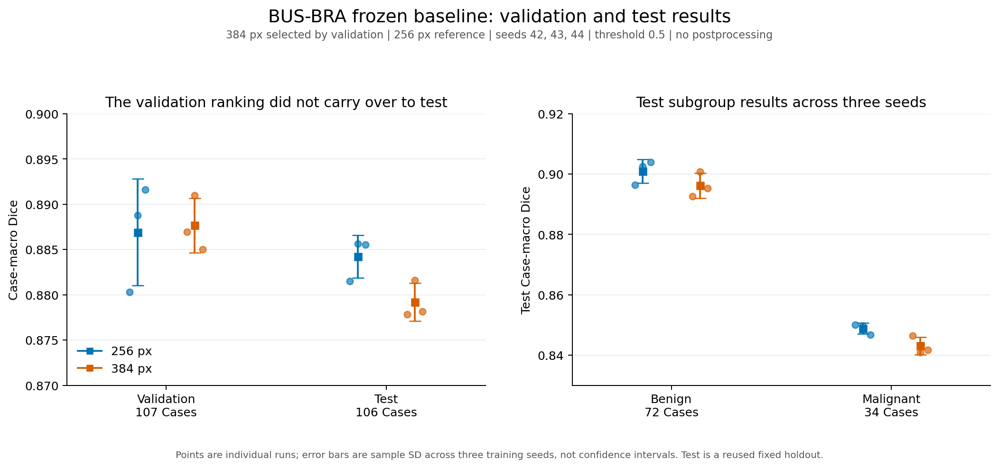

# BUS-BRA residual U-Net baseline

The baseline evaluation is complete. The 384-pixel setting was selected by mean
validation Case Dice across three training seeds. On the fixed test cohort, its
mean Case Dice was **0.8792 +/- 0.0021**. The 256-pixel reference achieved
**0.8842 +/- 0.0024** and had higher test Dice in all three matched seeds.
Increasing input resolution therefore did not improve the observed test result
in this experiment. The validation-selected primary setting remains identified
as 384; the test results are reported without retroactively changing that choice.

All +/- values below are **mean +/- sample standard deviation over three training
seeds**, not confidence intervals or standard errors. This is a baseline study,
with no claim of state-of-the-art or clinical performance.



## Dataset and split protocol

BUS-BRA was divided using complete supplied outer ten-fold assignments:

| Split | Outer folds | Images | Cases |
| --- | --- | ---: | ---: |
| Training | 3-10 | 1,489 | 851 |
| Validation | 2 | 193 | 107 |
| Test | 1 | 193 | 106 |

No Case ID crosses these splits. Related images of a Case remain together.
The supplied `valid_*` flags were not used for the baseline holdout. This is
**one fixed holdout with three training seeds per resolution**, not completed
ten-fold cross-validation. Repeated training seeds do not increase the number
of independent test Cases: every checkpoint was scored on the same 106 Cases.

The original 256/seed42 test result was inspected before the resolution study
finished. Although the resolution ranking used validation metrics, this is a
reused test cohort, not newly blind or independent external validation.

Dataset source: [original BUS-BRA repository](https://github.com/wgomezf/BUS-BRA).
Dataset citation: Gomez-Flores et al. (2024), Medical Physics,
[DOI: 10.1002/mp.16812](https://doi.org/10.1002/mp.16812).

## Model, preprocessing and training

- 2D MONAI residual U-Net: channels 32/64/128/256/512, four stride-2 reductions,
  two residual units per block and instance normalization; 6,494,716 parameters.
- Whole grayscale images scaled to [0,1], with aspect-preserving resize and
  centered zero letterboxing to 256 or 384 pixels. Masks use nearest-neighbour
  resizing. Letterbox padding is excluded from the loss.
- Equal-weight soft Dice and binary cross-entropy loss, AdamW with initial
  learning rate 0.001 and weight decay 0.0001; batch size 16.
- Horizontal flips with probability 0.5 for training only. No ground-truth crop
  or pathology label is supplied as an input feature.
- Training seeds 42, 43 and 44; maximum 100 epochs, early-stopping patience 20,
  validation Case Dice for checkpoint selection. ReduceLROnPlateau uses factor
  0.5 and patience 5.
- Training uses mixed precision. Exported validation/test scores use float32
  inference. Seeds and environments are recorded; bitwise portability across
  platforms is not claimed.

All six recorded runs used Python 3.10.12, Torch 2.14.1+cu126, MONAI 1.6.1,
NumPy 2.2.6, Pillow 12.3.0 and SciPy 1.15.3 on an NVIDIA RTX A6000.

## Evaluation

Predicted probabilities are restored to the original image dimensions after
removing padding, then thresholded at 0.5. No largest-component filtering or
other prediction postprocessing is applied. Dice, IoU, pixel recall and pixel
precision are first averaged over images of each Case, then over Cases with
equal Case weight. Pixel recall is not a lesion-detection rate.

HD95 is the maximum of the two directional 95th-percentile Euclidean boundary
distances, measured in native image pixels with four-neighbour boundaries.
Physical spacing was not established for this BUS-BRA experiment, so distances
are not reported in millimetres. An empty prediction against a nonempty target
has overlap scores zero and undefined HD95. There were no empty predictions or
undefined Case distances in these six test evaluations.

## Resolution selection using validation

The rule declared before the extra seed runs was to rank resolutions by mean
validation Case Dice across seeds 42/43/44, with exact ties favouring 256.

| Validation metric | 256 px | 384 px |
| --- | ---: | ---: |
| Case Dice | 0.8869 +/- 0.0059 | 0.8877 +/- 0.0030 |
| Benign Case Dice | 0.8958 +/- 0.0074 | 0.9025 +/- 0.0040 |
| Malignant Case Dice | 0.8678 +/- 0.0070 | 0.8558 +/- 0.0011 |
| Case HD95, native pixels | 26.49 +/- 1.22 | 26.50 +/- 1.39 |

The aggregate validation advantage for 384 was only +0.000747 Dice. It was not
consistent across seeds and came with lower malignant Case Dice in each seed.
The selected resolution and exact six checkpoint identities were frozen before
the remaining test evaluations. Largest-component filtering had previously been
rejected on validation because it reduced overall Case Dice and introduced
severe zero-overlap failures on individual images.

## Frozen test results

| Case-averaged test metric | 256 px reference | 384 px selected primary |
| --- | ---: | ---: |
| Dice | 0.8842 +/- 0.0024 | 0.8792 +/- 0.0021 |
| IoU | 0.8108 +/- 0.0038 | 0.8046 +/- 0.0028 |
| Pixel recall | 0.9019 +/- 0.0163 | 0.9025 +/- 0.0077 |
| Pixel precision | 0.8861 +/- 0.0172 | 0.8768 +/- 0.0064 |
| HD95, native pixels | 22.96 +/- 1.29 | 26.22 +/- 1.07 |
| Benign Dice: 72 Cases | 0.9010 +/- 0.0040 | 0.8962 +/- 0.0041 |
| Malignant Dice: 34 Cases | 0.8488 +/- 0.0018 | 0.8431 +/- 0.0029 |

| Training seed | 256 test Dice | 384 test Dice | 384 minus 256 |
| --- | ---: | ---: | ---: |
| 42 | 0.881520 | 0.877823 | -0.003697 |
| 43 | 0.885636 | 0.881602 | -0.004035 |
| 44 | 0.885563 | 0.878131 | -0.007432 |

The mean test difference was -0.005054 Dice for 384 minus 256, approximately
-0.505 percentage points on a 0-100 scale. Mean HD95 was 3.26 native pixels
higher at 384. Pixel recall was nearly unchanged. The observed reference
advantage is reported as a finding, without claiming general superiority from
three seeds and one reused cohort.

An exploratory paired Case bootstrap applied to the per-Case differences
averaged across the three fixed seed pairs gives a 95% interval of
[-0.014413, +0.004191], using 2,000 resamples and bootstrap seed 42. This spans
zero. It describes Case-sampling uncertainty conditional on these six fixed
checkpoints; it does not include training-seed variability or selection effects.
It must not be confused with the across-seed SD in the tables.

## Scanner subgroup description

| Test scanner | Cases | Mean Dice, 256 | Mean Dice, 384 |
| --- | ---: | ---: | ---: |
| GE Logiq 5 | 48 | 0.9092 | 0.9062 |
| GE Logiq 7 | 50 | 0.8860 | 0.8791 |
| Toshiba Aplio 300 | 8 | 0.7239 | 0.7173 |

These subgroup means are descriptive. The small Toshiba group and possible
differences in case composition do not establish a causal scanner effect.

## Reproduction and provenance

The project contains the split audit, baseline training/evaluation scripts,
resolution-repeat runner and frozen test runner. The combined validation and
test summaries retain configurations, model identities and per-Case scores.

To audit the summaries and regenerate the included figure and machine-readable
report, run from the project root with the existing venv active:

```bash
python report_baseline_results.py \
  --validation-summary reports/resolution_repeats/summary.json \
  --test-summary reports/frozen_resolution_test/summary.json \
  --output-dir reports/baseline_final_reproduced
```

Use a fresh output directory. This reporting program reads JSON only and does
not train, change checkpoints or run inference. Source SHA256 values and the
frozen checkpoint identities are recorded in `baseline_final_metrics.json`.
Server-specific absolute paths are omitted from that derived report.

## Next milestone

Keep these checkpoints and settings frozen. The next research step is external
validation with a separately acquired dataset before further optimization.
BUS-UCLM version 3 is a candidate source:
[official dataset record](https://data.mendeley.com/datasets/7fvgj4jsp7/3) and
[authors' tools](https://github.com/noeliavallez/BUS-UCLM-Dataset).
Audit its actual files and metadata before implementing a loader. It has RGB
lesion masks and normal images, so it requires an explicit mask-conversion and
empty-target evaluation protocol rather than reusing the BUS-BRA assumptions.
No BUS-UCLM results are claimed in this report.
