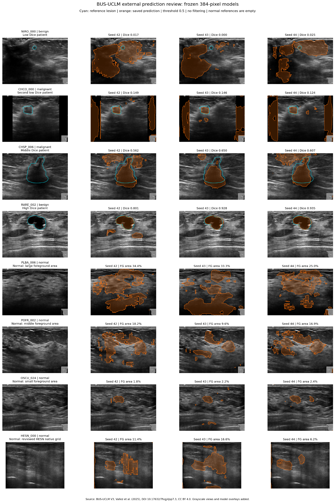

# Frozen BUS-BRA U-Net: external evaluation on BUS-UCLM V3

The frozen models have substantially lower segmentation scores on the external
cohort and predict foreground on every normal-reference image. The previously
validation-selected **384-pixel primary setting** achieves patient-macro Dice
**0.5782 +/- 0.0065**. The 256-pixel reference achieves **0.6054 +/- 0.0079**.
Values are mean +/- sample standard deviation across training seeds 42/43/44.
They are not confidence intervals or standard errors.

The models, threshold and preprocessing were not selected using these external
scores. Resolution 384 remains identified as primary, even though the reference
has higher observed external Dice. No clinical diagnostic or state-of-the-art
performance is established by this experiment.

## Audit and eligible cohort

The full aries audit reports all 683 source pairs decoded, no unexpected
errors, 679 eligible pairs and four quarantined positive references. Metadata,
manifest, geometry policy, implementation and all six checkpoint identities
match the declared protocol version 2.

| Analysis | Images | Patient prefixes |
| --- | ---: | ---: |
| Eligible positive segmentation | 260 | 35 |
| Benign positive images | 170 | 23 |
| Malignant positive images | 90 | 17 |
| Normal-image foreground burden | 419 | 35 |
| All eligible images | 679 | 38 |

Benign and malignant patient groups overlap: some patients have both image
labels. Positive and normal patient groups also overlap, and their two sets of
35 patients are not identical. The normal analysis concerns images labelled
normal, including images from patients who also have lesion-positive views.

HESN_002 through HESN_005 were excluded before external model predictions
because the nonempty 856-by-606 reference masks and differently sized images
had no validated coordinate mapping. Nine HESN normal masks were verified
entirely black and represented as empty arrays on their images' native grids
without interpolation. Raw images, original masks and INFO.csv were preserved.
The single Doppler=`Y` record remains unresolved, included in the full cohort
and excluded from the explicit Doppler=No secondary cohorts. This is an
eligibility-restricted evaluation, not overlap evaluation on every source image.

## Frozen method

The six checkpoints are the same MONAI residual U-Net models used in the
BUS-BRA study: 6,494,716 parameters, two input sizes, three training seeds each,
and best-checkpoint selection using BUS-BRA validation Case Dice. The source
study used one fixed Case-disjoint holdout, not completed ten-fold CV.

Each external image is converted to grayscale, divided by 255 and resized
with its aspect ratio preserved into a centered zero letterbox. Red and green
RGB reference pixels form one binary lesion class. No reference mask enters
the image input. External inference is float32 with AMP/TF32 disabled. Remove
padding from sigmoid probabilities, restore original image dimensions with
bilinear interpolation, then threshold at >=0.5. There is no postprocessing,
ensemble, external fine-tuning or threshold fitting.

All six exports record Python 3.10.12, PyTorch 2.14.1+cu126, MONAI 1.6.1,
NumPy 2.2.6, Pillow 12.3.0 and SciPy 1.15.3, on one visible NVIDIA RTX A6000
selected through CUDA_VISIBLE_DEVICES=3. Inference batch size is 16 with zero
workers. Seeds and deterministic-operation requests are recorded; bitwise
portability is not guaranteed.

## Positive-reference results

Per-image overlap metrics are averaged within each eligible patient and then
across patients equally. Pixel recall and precision concern segmentation
pixels; they are not diagnostic sensitivity or positive predictive value.

| Patient-macro external metric | 256 px reference | 384 px selected primary |
| --- | ---: | ---: |
| Dice | 0.6054 +/- 0.0079 | 0.5782 +/- 0.0065 |
| IoU | 0.4932 +/- 0.0105 | 0.4645 +/- 0.0053 |
| Pixel recall | 0.7169 +/- 0.0454 | 0.7223 +/- 0.0268 |
| Pixel precision | 0.6305 +/- 0.0219 | 0.5934 +/- 0.0172 |
| HD95, native pixels | 222.80 +/- 11.16 | 264.96 +/- 38.01 |
| Benign-image Dice | 0.5140 +/- 0.0047 | 0.4843 +/- 0.0294 |
| Malignant-image Dice | 0.6329 +/- 0.0070 | 0.6082 +/- 0.0137 |

| Training seed | 256 patient Dice | 384 patient Dice |
| --- | ---: | ---: |
| 42 | 0.614429 | 0.585447 |
| 43 | 0.601767 | 0.573029 |
| 44 | 0.599969 | 0.575986 |

There are no empty positive-reference predictions or undefined positive HD95
values in these exports: every run has 260 defined image distances and 35
fully defined patient distances. Nonempty predictions can still have zero
overlap or distant false-positive components. HD95 is the maximum directional
95th-percentile Euclidean boundary distance, with four-neighbour boundaries,
in native pixels. Physical spacing is not established for these PNG exports;
the pixel distances should not be compared across datasets as physical lengths.

The observed mean Dice difference, 384 minus 256, is -0.027234, or -2.72
percentage points on a 0-100 Dice scale. After averaging each patient's Dice
across its three fixed seed models, 384 has lower Dice for 26 patients and
higher Dice for nine. An exploratory paired patient bootstrap with 2,000
resamples and RNG seed 42 gives a 95% interval [-0.039363, -0.015287]. This
describes patient-sampling uncertainty conditional on these fixed checkpoints,
and excludes training-seed and model-selection uncertainty. It does not justify
retroactive model selection or a general claim that the smaller input is superior.

The original per-checkpoint patient bootstrap intervals were also checked.
They remain separate from the across-seed SD and the exploratory paired interval.

## Normal-image foreground burden

Every one of the 419 normal-reference images has at least one predicted
foreground pixel in each of the six runs. This uses the declared any-pixel
criterion at threshold 0.5 without size filtering. The predicted area is also
substantial: after averaging images within patient, then patients equally,
the mean foreground fraction is 13.57% at 256 and 15.62% at 384.

| Normal-image segmentation measure | 256 px reference | 384 px selected primary |
| --- | ---: | ---: |
| Patient-macro predicted area, % of image | 13.57 +/- 3.94 | 15.62 +/- 1.70 |
| Images with any foreground, each seed | 419 / 419 | 419 / 419 |
| Patients with foreground on a normal view, each seed | 35 / 35 | 35 / 35 |

Area SD is expressed in percentage points. Its denominator is the full native
image area, including original borders and overlays. Normal overlap scores
are not mixed into the positive Dice average. These are segmentation
false-positive measures on normal-labelled images, not patient diagnostic
specificity; many patients also have positive-reference views.

## Comparison with the BUS-BRA source experiment

| Setting | BUS-BRA fixed test Case Dice | BUS-UCLM eligible positive patient Dice |
| --- | ---: | ---: |
| 256 px | 0.8842 +/- 0.0024 | 0.6054 +/- 0.0079 |
| 384 px primary | 0.8792 +/- 0.0021 | 0.5782 +/- 0.0065 |

For the selected setting, the observed difference between cohort means is
-0.3010 Dice, approximately -30.1 percentage points. This is a descriptive
comparison of different cohorts and grouping definitions, not a paired
cross-dataset treatment effect or proof of a specific cause. The BUS-BRA test
cohort was a reused fixed holdout of 193 images / 106 Cases; the external
positive cohort has 260 images / 35 eligible patients. The same patients are
reused across training-seed evaluations within each dataset.

## Secondary descriptions

| Positive-reference subset | Images / patients | 256 Dice | 384 Dice |
| --- | --- | ---: | ---: |
| Doppler=No, Combined=No | 224 / 35 | 0.6012 +/- 0.0101 | 0.5775 +/- 0.0105 |
| Above plus Marks=No | 115 / 29 | 0.5830 +/- 0.0105 | 0.5405 +/- 0.0234 |
| Doppler=Yes | 34 / 17 | 0.7236 +/- 0.0204 | 0.6822 +/- 0.0057 |
| Marks=Yes | 142 / 34 | 0.6522 +/- 0.0080 | 0.6379 +/- 0.0094 |
| Marks=No | 118 / 29 | 0.5751 +/- 0.0109 | 0.5332 +/- 0.0241 |

These subsets were specified before inference, overlap, differ in case
composition and have unequal patient counts. The results do not establish
that marks or Doppler improve performance. The combined-positive subset has
only one image from one patient and is not a reliable basis for general conclusions.

## Completed saved-prediction review

The uploaded review covers eight selected images from eight patients, with
the same three frozen 384-pixel models shown for each image: 24 saved masks
in total. The review protocol hash matches the completed external export.
Its summary records that the masks were reloaded, checked on the native grids,
rescored and compared with the saved per-image results on aries. No new
inference or model changes were performed. Integer pixel counts and overlap
arithmetic in the uploaded review are internally consistent.

Cyan contours are the supplied reference; orange regions are saved model
predictions. These examples were selected deterministically to span patient
Dice and normal-image foreground burden. They are illustrative examples, not
a representative random sample and not an additional evaluation cohort.

| Image | Dice, seeds 42 / 43 / 44 | Observed failure or control |
| --- | --- | --- |
| NIRO_000, benign | 0.017 / 0.000 / 0.025 | The reference occupies 0.31% of the native image, whereas predictions occupy 24.2-35.3%. Large false-positive regions dominate; seed 43 misses the reference entirely. |
| CHCO_000, malignant | 0.149 / 0.146 / 0.124 | Part of the reference lesion is captured, alongside large predicted regions along the original side borders. Pixel recall is 0.62-0.66 but precision only 0.069-0.084. |
| CHSP_006, malignant | 0.562 / 0.650 / 0.607 | The upper part of the reference is missed; separate predicted regions appear above it. |
| RARE_002, benign | 0.801 / 0.928 / 0.935 | Seeds 43 and 44 follow the reference closely. Seed 42 adds distant components, with HD95 181.3 pixels versus 19.2 and 16.1 pixels for the other seeds. |

| Normal-reference example | Predicted area, seeds 42 / 43 / 44, % of native image |
| --- | --- |
| PLBA_006, large foreground burden | 34.4 / 33.3 / 25.0 |
| POFR_002, middle foreground burden | 18.2 / 9.6 / 16.9 |
| OSCU_024, small foreground burden | 1.8 / 2.2 / 2.4 |
| HESN_000, native-grid control | 11.4 / 16.6 / 6.2 |

Normal-image predictions occur within the ultrasound image as well as at
some borders. In particular, PLBA_006 shows large interior regions across
all three seeds; the normal false-positive finding is not confined to isolated
single-pixel detections. The HESN_000 reference is empty on its verified
620-by-489 native image grid, as specified by the geometry amendment.

There is no obvious common translation, rotation or scale error in the four
displayed positive-reference examples. RARE_002 provides a close-overlap
control. This visual observation is limited to the displayed examples and
does not prove alignment across the full dataset. It also does not determine
the clinical validity of individual source annotations.

The detailed uploaded review is included at
`docs/busuclm_external_prediction_review.json`. Its protocol and scalar checks,
source hashes and review limitations are recorded separately in
`docs/busuclm_prediction_review_verification.json`.

## Interpretation and next step

The observed results show limited transfer of this frozen positive-image
segmentation baseline to the eligible external cohort, together with large
foreground predictions on normal-reference images. A plausible contributor
is that the BUS-BRA training set in this baseline contained annotated lesions
and did not include normal-image negatives. Differences in acquisition,
appearance, lesion size and reference conventions may also matter. These
exports and selected overlays do not isolate a cause.

This baseline's aggregate evaluation and selected prediction review are now
complete. Preserve the original checkpoints, protocol, source audit, all six
evaluation folders and the completed review. Report the source study as one
fixed Case-disjoint holdout with three training seeds per resolution, followed
by eligibility-restricted external evaluation on BUS-UCLM V3. It is not a
completed ten-fold cross-validation experiment. The 384-pixel setting remains
the declared primary result.

For a future improvement study, a candidate is to include appropriately
annotated normal-image negatives from a separate development cohort and
assess foreground suppression alongside positive-lesion segmentation. Normal
negatives were absent from this baseline's training images; their contribution
to the observed failure has not been isolated. Any such study needs its own
patient-disjoint training/validation assignments and a new frozen evaluation
plan. No threshold, border crop or component filtering is selected from these
external examples.

Keep this evaluation frozen. Choose future model changes using designated
training and validation data. If BUS-UCLM feedback is used to choose model or
postprocessing settings, it becomes development feedback and a new independent
assessment is needed. The current observed external cohort is no longer an
unseen source for subsequent development decisions.

## Verification limits and reproduction

The received audit and combined exports were checked against the original
metadata, geometry policy and source implementation. Patient/image counts,
all patient-macro and image-weighted means, benign/malignant and marks
partitions, HD95 availability/means, across-seed SD and per-run bootstrap
intervals were recomputed. All six model hashes and epochs match the prior
BUS-BRA test exports. No inconsistency was found in those exported summaries.

The actual eight-image gallery and its selected-score JSON were subsequently
uploaded and reviewed. Their protocol identity, dimensions, metadata and scalar
score arithmetic were checked, and the four positive and four normal overlays
were inspected visually. Native prediction-mask files and the complete
per-image score exports were not uploaded. The local checks therefore do not
independently recompute native pixel intersections or HD95 from the composite
PNG and do not establish pixel-level correctness across all 679 images. The
aries review script reports successful selected-mask rescoring. Reproduction
details and commands are in `README_BUSUCLM_RESULTS.md`; aggregate source input
hashes are in `busuclm_external_metrics.json` and new review-source hashes are
in `docs/busuclm_prediction_review_verification.json`.

## Attribution

Vallez, Noelia; Bueno, Gloria; Deniz, Oscar; Rienda, Miguel Angel; Pastor,
Carlos (2025), *BUS-UCLM: Breast ultrasound lesion segmentation dataset*,
Mendeley Data, V3, [doi:10.17632/7fvgj4jsp7.3](https://doi.org/10.17632/7fvgj4jsp7.3),
[CC BY 4.0](https://creativecommons.org/licenses/by/4.0/). See also the paper
in Scientific Data 12, 242 (2025),
[doi:10.1038/s41597-025-04562-3](https://doi.org/10.1038/s41597-025-04562-3).
The geometry amendment and model overlays are project-specific changes and
do not imply endorsement by the dataset authors.

BUS-BRA: Gomez-Flores et al. (2024), *BUS-BRA: A Breast Ultrasound Dataset for
Assessing Computer-aided Diagnosis Systems*, Medical Physics,
[doi:10.1002/mp.16812](https://doi.org/10.1002/mp.16812).
