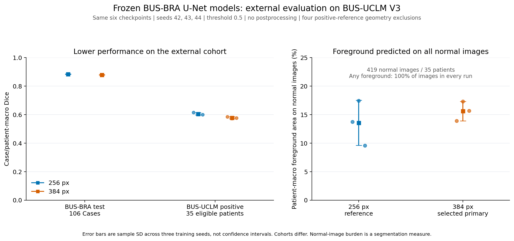

# Breast Ultrasound Lesion Segmentation

A MONAI residual U-Net baseline trained on **BUS-BRA**, with grouped data
splits, validation-based checkpoint selection, and a frozen external evaluation
on **BUS-UCLM V3**. The project covers data auditing, training, native-resolution
evaluation, reproducibility records, and visual failure analysis.

**Experiment scope:** one fixed BUS-BRA holdout, two input resolutions, and
three training seeds per resolution. This is **not completed ten-fold
cross-validation**. Resolution 384 was selected using validation data and
remains the primary setting throughout the reported test and external results.

## Results at a glance

All values are mean ± **sample standard deviation across seeds 42, 43 and 44**.
The same evaluation cohort is reused across seeds; these are not independent
test datasets. Standard deviations are not confidence intervals.

| Measure | 256 px reference | 384 px selected primary |
| --- | ---: | ---: |
| BUS-BRA validation Case Dice | 0.8869 ± 0.0059 | 0.8877 ± 0.0030 |
| BUS-BRA test Case Dice | 0.8842 ± 0.0024 | 0.8792 ± 0.0021 |
| BUS-UCLM positive-image patient Dice | 0.6054 ± 0.0079 | 0.5782 ± 0.0065 |
| BUS-UCLM normal-image predicted area, % | 13.57 ± 3.94 | 15.62 ± 1.70 |

BUS-BRA test results use 193 images from 106 supplied `Case` groups. External
positive segmentation uses 260 eligible images from 35 patient prefixes.
External normal-image foreground burden uses 419 images from 35 patient
prefixes, with images averaged within patient before patients receive equal
weight. The two external groups overlap but do not have identical patient sets.



The main finding is limited transfer to the external cohort, together with
substantial predicted foreground on normal-reference images. Each of the six
models predicts at least one foreground pixel on every one of the 419 normal
images at the fixed threshold of 0.5. This is a segmentation false-positive
measure, not patient diagnostic specificity. Dataset differences and the
absence of normal-image negatives in source training are possible contributors;
this experiment does not isolate their effects.

The reference setting has higher observed test and external Dice. The primary
setting is retained because model selection used validation data, whose mean
Dice advantage for 384 was only 0.000747. No setting or winning seed is selected
using the external scores.

Detailed results: [BUS-BRA report](BASELINE_RESULTS.md),
[BUS-UCLM report](BUSUCLM_EXTERNAL_RESULTS.md),
[source metrics](baseline_final_metrics.json), and
[external metrics](busuclm_external_metrics.json).

## Data and split design

### BUS-BRA source experiment

The 1,875 image/mask pairs are grouped by the supplied `Case` identifier.
Complete outer folds from `10-fold-cv.csv` define a single fixed partition:

| Split | Supplied outer folds | Images | Cases |
| --- | --- | ---: | ---: |
| Training | 3–10 | 1,489 | 851 |
| Validation | 2 | 193 | 107 |
| Test | 1 | 193 | 106 |

No supplied Case ID crosses these partitions. The `valid_*` flags are audited
but not used to create the holdout because they separate some related images.
The grouping guarantee covers relationships recorded in the released metadata.

Preparation checks file identities, binary masks, image/mask agreement and
decoded dimensions. Four CSV dimension discrepancies are recorded using the
matching PNG pair dimensions; source CSV files are preserved. Invalid masks,
corrupt images and unresolved image/mask disagreement still fail preparation.

### BUS-UCLM external cohort

The V3 source contains 683 images from 38 patient prefixes. All source pairs
were audited. Protocol version 2 admits 679 images:

- **260 positive-reference images:** 170 benign and 90 malignant, 35 patients.
- **419 normal-reference images:** empty reference masks, 35 patients.
- **Four positive-reference exclusions:** `HESN_002`–`HESN_005`, whose source
  image and mask grids could not be mapped reliably from the supplied files.

Nine mismatched but verified all-black HESN normal masks are represented as
empty arrays on their native image grids in memory. Positive masks are not
stretched or shifted to guess alignment. These rules were documented before
external predictions and apply only to byte-identified source pairs. Raw files
remain intact, including excluded pairs.

RGB green and red reference pixels are combined into one binary lesion class.
Normal-image results are kept separate from positive-reference Dice. Images
with marks, Doppler or combined views remain in the primary eligible cohort;
prespecified subgroup summaries are descriptive.

See [dataset layout and attribution](docs/DATASETS_AND_ATTRIBUTION.md),
[external protocol v2](docs/BUSUCLM_EXTERNAL_PROTOCOL.md), and
[geometry amendment](docs/BUSUCLM_GEOMETRY_AMENDMENT.md).

## Model and training

| Component | Setting |
| --- | --- |
| Network | MONAI 2D residual U-Net, 6,494,716 parameters |
| Channels / strides | 32, 64, 128, 256, 512 / four stride-2 reductions |
| Residual units / normalization | 2 / instance normalization |
| Input / output | One grayscale channel / one lesion logit channel |
| Image preprocessing | Divide intensities by 255; aspect-preserving bilinear resize; centered zero letterbox |
| Input resolutions | 256 × 256 and 384 × 384 |
| Reference resizing | Nearest neighbour; nonempty lesions cannot silently vanish |
| Loss | 0.5 soft Dice + 0.5 BCE with logits, excluding letterbox padding |
| Optimizer | AdamW, initial learning rate 0.001, weight decay 0.0001 |
| Batch size / training seeds | 16 / 42, 43, 44 |
| Augmentation | Joint horizontal flip, probability 0.5, training only |
| Training budget | Maximum 100 epochs; early-stopping patience 20 |
| Learning-rate schedule | ReduceLROnPlateau on validation Case Dice; factor 0.5, patience 5 |
| Checkpoint selection | Highest validation Case Dice for each run |
| Precision | Mixed-precision CUDA training; float32 exported evaluation |

The model receives the whole image. Ground-truth boxes and pathology labels
are not supplied as model inputs. There is no ensemble, component filtering,
external fine-tuning, or external threshold fitting in the reported experiment.

## Evaluation

Remove letterbox padding from sigmoid probabilities, resize them bilinearly
back to the native image grid, and threshold at **≥0.5**. Native binary masks
are used for scoring.

Dice, IoU, pixel recall and pixel precision are averaged over images within
each source Case or external patient, then across groups equally. These pixel
metrics are not clinical diagnostic sensitivity or predictive value.

HD95 is the larger of the two directional 95th-percentile Euclidean boundary
distances, using four-neighbour boundaries and **native pixels**, not
millimetres. Against a nonempty reference, an empty prediction receives zero
overlap and undefined HD95; undefined counts accompany distance summaries.
The six reported runs have no undefined positive-reference HD95 values.
External normal references receive foreground-area and any-foreground summaries
instead of overlap scores mixed into positive Dice.

## Saved-prediction review

The completed review displays eight selected images for all three primary
384-pixel models. Its aries script verifies source and saved artifact identities,
reloads native masks, recomputes selected pixel scores and checks them against
the stored exports. The uploaded gallery and JSON were inspected, including
scalar checks for all 24 displayed predictions.

| Example | Observed behavior |
| --- | --- |
| `NIRO_000` | Small reference lesion; Dice 0.000–0.025 with much larger predicted regions |
| `CHCO_000` | Partial lesion overlap plus substantial predictions along original side borders |
| `CHSP_006` | Missed upper reference region and separate predicted regions above it |
| `RARE_002` | Close reference overlap for seeds 43/44; distant components for seed 42 |
| `PLBA_006` | Empty normal reference; predictions cover 25–34% of the native image |

There is no obvious common geometric shift in the four displayed positive
examples. This does not prove alignment across the entire dataset. The
examples were selected to span score and foreground burden, not as a random
sample. Full native prediction arrays were not provided for independent
local pixel-by-pixel re-evaluation of all 679 images.

[View the actual prediction gallery](figures/busuclm_external_predictions_review.png)
and [selected-score review](docs/busuclm_external_prediction_review.json).
Source: BUS-UCLM V3, Vallez et al. (2025),
[DOI 10.17632/7fvgj4jsp7.3](https://doi.org/10.17632/7fvgj4jsp7.3),
[CC BY 4.0](https://creativecommons.org/licenses/by/4.0/).
Grayscale views, reference contours and model overlays were added; this does
not imply endorsement by the dataset authors.

## Setup and first run

Run commands from the repository root after downloading the datasets separately.
The completed experiments recorded Python 3.10.12, PyTorch 2.14.1+cu126,
MONAI 1.6.1, NumPy 2.2.6, Pillow 12.3.0 and SciPy 1.15.3, using an NVIDIA
RTX A6000. These are recorded run versions, not a claim about the latest releases.

Activate the existing environment, or create a virtual environment on a new
machine. Install a CUDA-enabled PyTorch build compatible with that environment
using the [official installation instructions](https://pytorch.org/get-started/locally/),
then install the remaining baseline dependencies:

```bash
source .venv/bin/activate
python -m pip install -r requirements-baseline.txt
python -m pip check
```

For a directly allocated physical GPU 3:

```bash
export CUDA_DEVICE_ORDER=PCI_BUS_ID
export CUDA_VISIBLE_DEVICES=3
python -c 'import torch; print(torch.cuda.is_available(), torch.cuda.device_count())'
```

That process sees the selected GPU as logical `cuda:0`. On a managed cluster,
retain the scheduler's GPU visibility settings.

Prepare the source manifest and run the baseline checks:

```bash
python scripts/prepare_splits.py
python -m unittest discover -s tests -p test_baseline.py -v
```

Then perform a short operational check in a fresh output directory:

```bash
python scripts/train_baseline.py --smoke --num-workers 0 \
  --run-dir runs/unet_smoke_reproduction
```

Smoke scores are not research results, and smoke checkpoints are rejected by
the evaluation scripts. Choose fresh paths for repeated runs.

For full training, all six runs, validation review, evaluation and reporting,
see [reproduction instructions](docs/REPRODUCIBILITY.md). The exact historical
frozen evaluators require the original checkpoint identities; those weights
and the raw datasets are not distributed with this documentation.

## Limitations

- One source holdout and three seeds per resolution do not establish population
  performance or general superiority of a resolution.
- The original 256/seed42 source test score was inspected before the resolution
  study finished. The source test set is a reused holdout, not a newly blind cohort.
- External positive segmentation excludes four unresolved references. Published
  results with different eligibility rules are not directly comparable.
- Normal-image negatives were absent from source training. External false
  positives are substantial; clinical validity and deployment readiness are
  not established.
- Dataset, scanner, annotation and lesion-size differences were not isolated
  experimentally. Native-pixel distances are not physical cross-dataset distances.
- Seeds and deterministic-operation requests are recorded; bitwise portability
  across hardware and library versions is not guaranteed.
- BUS-UCLM has now been observed. Any method selected using this feedback needs
  a separate independent assessment. Future changes should be chosen using
  designated training and validation data.

## Documentation

- [BUS-BRA results and uncertainty](BASELINE_RESULTS.md)
- [BUS-UCLM results and failure analysis](BUSUCLM_EXTERNAL_RESULTS.md)
- [Reproduction and frozen checkpoint identities](docs/REPRODUCIBILITY.md)
- [Dataset preparation, source attribution and licences](docs/DATASETS_AND_ATTRIBUTION.md)
- [External protocol v2](docs/BUSUCLM_EXTERNAL_PROTOCOL.md)
- [Geometry amendment](docs/BUSUCLM_GEOMETRY_AMENDMENT.md)
- [GitHub publishing guide](docs/GITHUB_PUBLISHING.md)

## References and licensing

Gómez-Flores, W., Gregorio-Calas, M. J., and de Albuquerque Pereira, W. C.
(2024). *BUS-BRA: A Breast Ultrasound Dataset for Assessing Computer-aided
Diagnosis Systems*. Medical Physics, 51, 3110–3123.
[Paper](https://doi.org/10.1002/mp.16812) ·
[Dataset](https://zenodo.org/records/8231412) ·
[Authors' code](https://github.com/wgomezf/BUS-BRA).

Vallez, N., Bueno, G., Deniz, O., Rienda, M. A., and Pastor, C. (2025).
*BUS-UCLM: Breast ultrasound lesion segmentation dataset*. Mendeley Data, V3.
[Dataset](https://data.mendeley.com/datasets/7fvgj4jsp7/3) ·
[Dataset DOI](https://doi.org/10.17632/7fvgj4jsp7.3) ·
[Paper, Scientific Data 12, 242](https://doi.org/10.1038/s41597-025-04562-3).

BUS-UCLM V3 is licensed under CC BY 4.0. Follow the BUS-BRA release terms and
citation requirements when acquiring its data. Dataset licences, third-party
code licences and any existing project licence apply separately. This
documentation does not assign a new licence to project code.
